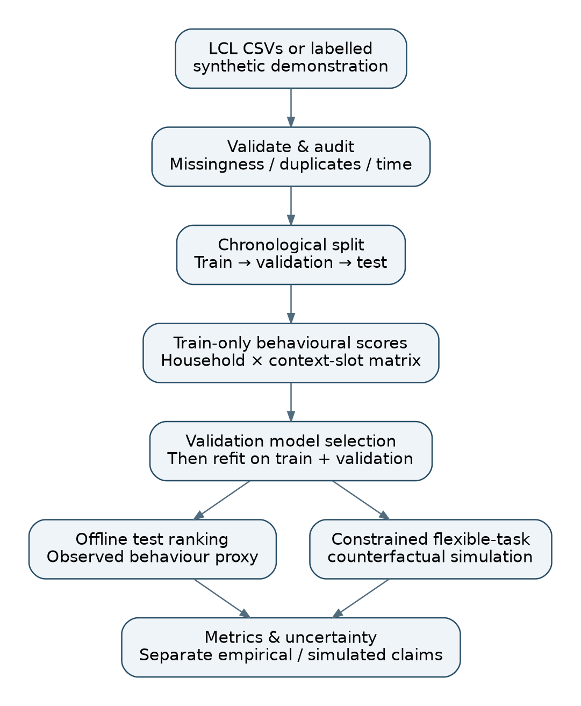

# Explainable Hybrid Collaborative Filtering for Residential Demand Response

A runnable Python research foundation for **“An Explainable Hybrid Collaborative Filtering Framework for Personalised Residential Demand Response and Energy Cost Optimisation.”**

**Status:** the bundled results are from an executed, explicitly synthetic demonstration. No real Low Carbon London measurements are bundled or evaluated. The original LCL column schema is tested using constructed fixtures. This is a research implementation, not a validated energy-saving product or a finished publication.

## Quick start — Ubuntu/Linux, Python 3.11 or 3.12

```bash
unzip Energy_Recommender_System_Complete.zip
cd energy-recommender-system
sudo apt-get update
sudo apt-get install -y python3-venv python3-dev build-essential graphviz
bash scripts/setup.sh
source .venv/bin/activate
python -m pytest -q
python -m src.pipeline --config config.yaml
python tools/generate_diagrams.py
python tools/generate_result_figures.py
streamlit run dashboard.py
```

The final dashboard command is optional and starts a local server. See [INSTALLATION.md](INSTALLATION.md) for VS Code, notebooks, real data and troubleshooting. All commands run from this repository directory. `scripts/setup.sh` installs the pinned core dependencies and the local package; it uses GCC when no compiler is selected. Do not use Python 3.13+ with this tested dependency set.

## Research problem and design
Household meter readings reveal repeating usage patterns, but do not directly reveal flexible appliances or user preferences. The project estimates **behavioural compatibility** for time slots, combines it with an explicit tariff and availability constraints, and evaluates a separately assumed flexible task.

The distinction between two experiments is essential:

- **Offline ranking:** can historical models recover future high-affinity time slots? This is a proxy task based on aggregate activity.
- **Counterfactual simulation:** under assumed task energy, availability and tariff, what happens if an added task runs at a recommended time? These are simulated savings, not measured demand response.



## Dataset and loading
The [official Low Carbon London dataset](https://data.london.gov.uk/dataset/smartmeter-energy-consumption-data-in-london-households-vqm0d) is the primary target. Download its full or split archive manually from the provider, verify the licence and extract CSV files into `data/raw/lcl/`. Preserve source filenames, access date, checksums, tariff-group metadata and any licence files. Actual historical tariff-calendar ingestion is **not** implemented: the default tariff is an illustrative daily scenario.

Supported columns:

| Generic | Original LCL |
|---|---|
| `household_id` | `LCLid` |
| `timestamp` | `DateTime` |
| `kwh` | `KWH/hh (per half hour)` (surrounding header spaces accepted) |

`kwh` means energy during a half hour, not instantaneous kW. CSVs are read in chunks; `max_households` restricts the retained cohort before concatenation. The default first-encountered 100-household cap is an engineering convenience, **not a representative statistical sample**. Set a justified cohort before publishing. Loading all households still concatenates retained rows and the models use dense matrices, so a full 167-million-row run requires a different out-of-core storage/training design.

```bash
python scripts/preprocess.py --input data/raw/lcl --config config.yaml
python -m src.pipeline --config config.yaml --input data/raw/lcl
```

The complete pipeline overwrites the configured results and `data/processed/`; copy the bundled demo outputs before running a different study. Separate experiment directories are recommended. The standalone preprocessing command is exploratory and does not perform the cold-household holdout; the full pipeline owns the experimental split and holdout.

Validation rejects missing IDs, malformed numeric values, negative/infinite energy, misaligned timestamps and conflicting duplicate readings. Exact duplicates collapse. Missing numeric values remain flagged, are excluded from interaction calculations, and are counted separately from absent intervals. No future interpolation is used. Naive timestamps default to `Europe/London`; ambiguous/nonexistent DST clocks are rejected. Resolve the source time convention rather than guessing: offset-aware/UTC input is preferred. `timezone: UTC` is appropriate only when the source is known to use UTC. Behavioural slots always use London local time. The simulator excludes non-48-slot and incomplete local days and reports coverage.

## Interaction construction
Users are households. Items are `48 * daytype + half_hour_slot`, with weekday=0 and weekend=1. The 96-item vocabulary permits repeat recommendations of previously used time slots.

Training-fitted household quantiles define activity and magnitude scales. Affinity combines active frequency, bounded household-normalised energy and usage consistency:

```text
a_ui = frequency_ui * (0.5 + 0.5 * bounded_magnitude_ui)
                         * (0.5 + 0.5 * consistency_ui)
confidence_ui = 1 + 20 * frequency_ui * n_ui / (n_ui + 5)
```

This bounded heuristic is transparent but is not an identified utility model. Cold households use population training statistics. See [mathematical formulation](docs/mathematical_formulation.md) for definitions, assumptions and learning objectives. Training interactions are exported to `data/processed/interactions.csv`.

## Implemented models

| Name | Learning objective / role |
|---|---|
| Popularity | Mean observed behavioural affinity by context-slot |
| PooledPopularity | Same population baseline with weekday/weekend pooled |
| UserKNN / ItemKNN | Surprise cosine neighbours on pseudo-ratings |
| SVD | Surprise regularised bias-plus-factor pseudo-rating model |
| NMF | Surprise nonnegative pseudo-rating factors |
| PooledImplicitALS | Confidence-weighted binary implicit learning without daytype |
| ImplicitALS | Same implicit-learning family with weekday/weekend item splitting |
| Hybrid | Feasible ranking using contextual ALS, price, peak and inconvenience |

Surprise is used only for compatible score-as-rating baselines. The custom NumPy ALS minimises an all-pairs confidence-weighted objective with binary affinity-threshold targets and weakly weighted unobserved pairs. This is different from fitting continuous pseudo-ratings. Validation selects small grids for neighbours/factors/regularisation; selected models are refitted on train + validation and persisted with `joblib`. Only load trusted local model files.

```bash
python scripts/recommend.py --model results/models/ImplicitALS_11.joblib --household H0000
```

This saved-model command returns behavioural rankings. Feasible hybrid rankings and explanations are produced by the full experiment and saved to `recommendations.csv`. Training and evaluation deliberately share a single orchestration entry point to keep split/model selection consistent, instead of maintaining several conflicting implementations.

## Hybrid objective and task constraints

```text
score = alpha * predicted_compatibility
      - beta  * normalised_tariff
      - gamma * normalised_training_peak_profile
      - delta * normalised_absolute_time_shift
```

Signals use full-day min–max normalisation; constant signals contribute zero. Default weights are `[0.4,0.3,0.2,0.1]`, a scenario choice, not a learned optimum. The illustrative tariff is £0.14/kWh before 07:00, £0.40/kWh from 16:00 to 20:00, and £0.24 otherwise. It is neither a current retail offer nor the LCL historical dynamic tariff.

The default task is 1 kWh over one half hour at 18:00, allowed between 14:00 and 22:00, with maximum shift four hours. Both the original and shifted scenario **add** the same task to the underlying meter profile. The engine does not extract or shift total measured demand. Constraints are enforced before ranking. Task windows do not cross midnight; multi-slot or multi-appliance scheduling is future work.

Optional `constraints_csv` permits household-specific overrides with columns:

```csv
household_id,original_slot,max_shift,availability_start,availability_end
H0000,36,4,32,42
H0001,34,6,28,40
```

Slots and shifts are half-hour units; interval endpoints are inclusive. Default constraints apply to households without overrides. Optional `carbon_csv` accepts exactly one supplied daily profile with `slot,gco2_per_kwh`, slots 0–47, plus a mandatory `carbon_provenance` string. It repeats that profile as a scenario; date-specific carbon alignment is not implemented and no carbon result is bundled.

Explanations include the proposed local time, assumed tariff, original task cost, predicted compatibility, feasible window, and exact signed score contributions. They do not claim causal savings or appliance-level preference.

## Evaluation and experimental design
The default demo uses 36 synthetic households and 84 × 48 intervals per household, a chronological 60/20/20 split by local date, five held-out households and model seeds 11, 22, 33. Because the interval range crosses daylight saving, local dates include partial boundary days. Metadata records exact split timestamps and simulation eligibility counts.

- Precision@5, Recall@5, NDCG@5 and HitRate@5 use complete observed 48-slot household-context sets with at least one relevant slot (affinity≥0.5). Coverage counts are reported. Previously used items are not removed.
- RMSE/MAE are computed for Surprise pseudo-rating baselines across observed test scores, independently of positive-item eligibility.
- Energy tables report simulated augmented bill savings, individual peaks, absolute time shift, normalized inconvenience and violations. Aggregate daily peak tables sum profiles **before** taking the maximum, allowing negative reductions/rebound.
- Cold-start experiments remove households from fitting and selection. Unknown households receive population fallback, not invented personalised predictions.
- Four leave-one-weight-out ablations and five levels for each of α, β, γ, δ are executed without selecting weights on test outcomes.
- Household-bootstrap intervals average repeated dates/seeds first; paired hybrid-versus-baseline differences preserve household matching. Across-seed variation is separately reported.

See [experimental protocol](docs/experimental_protocol.md), [execution report](docs/execution_report.md), and [research contribution boundaries](docs/research_contributions.md). Synthetic ranking can be very easy; perfect scores here do not support claims of superiority on LCL.

## Repository map

| Location | Purpose |
|---|---|
| `src/data.py` | Chunked loader, validation, synthetic generator, temporal split |
| `src/preprocessing.py` | Train-fitted household affinity/confidence |
| `src/models.py` | Popularity, Surprise baselines, pooled/contextual implicit ALS |
| `src/energy.py` | Tariff, constraints, objective and flexible-task accounting |
| `src/evaluation.py` | Ranking metrics and household bootstrap |
| `src/recommend.py` | Saved-model inference |
| `src/pipeline.py` | Tuning, refit, holdouts, explanations, simulations and exports |
| `scripts/` | Setup, preprocessing, synthetic generation, inference and pipeline launch |
| `tools/` | Reproducible diagram/chart/notebook generation and execution |
| `notebooks/` | Five worked tutorials |
| `tests/` | Regression and scientific-invariant tests |
| `data/synthetic/` | Labelled demonstration readings |
| `data/processed/` | Splits and interaction CSV |
| `results/models/` | Saved fitted models |
| `results/tables/` | Executed experiments and descriptive summaries |
| `results/figures/` | PNG, editable SVG and PDF figures |
| `docs/diagrams/` | Editable Graphviz DOT sources |

The implementation consolidates closely related modules instead of adding empty wrappers for every suggested filename. Every referenced executable module is present.

## Limitations, extensions and schedule
The synthetic sample is stylized, largely stationary, small and not population-representative. Aggregate consumption does not identify availability, appliance type, causal preference or willingness to shift. The confidence rule, relevance threshold, task definition and weights require validation. The small hyperparameter grid is a demonstration, not an exhaustive benchmark. Independent recommendations may synchronize demand; a profile penalty is not a feeder constraint. Calendar alignment, seasonal generalization, actual tariff calendars, field trials, scaling and participant feedback remain necessary.

[Six-week roadmap](docs/roadmap.md) describes a realistic real-data pilot and future Ausgrid PV, REFIT appliance and ACN-Data charging extensions. These extensions are documented, not implemented. [References](docs/references.md) lists verified research sources and provider links. Code is MIT-licensed; third-party data retain their own licences.
